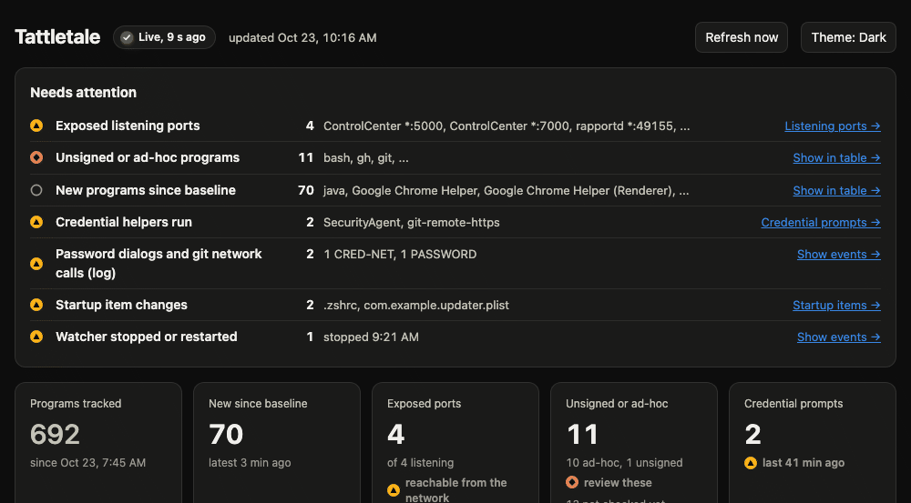

# Tattletale

Tattletale tells you what's going on behind your back on macOS: who asked for your
passwords, what opened a port, what new program ran, and what changed at login. Read-only,
no dependencies, with a local dashboard.

> **Beta, version 0.0.2.** It works and is tested on macOS, but expect rough edges and
> changes to the data format.

## Two versions, one dashboard

Tattletale comes in two versions that do exactly the same job. Pick whichever runtime you
already have:

| Version | Run it with | Needs |
|---|---|---|
| **Python** (`python/`) | `python3 python/tattletale.py` | Python 3.9 or newer; nothing to install |
| **Java** (`java/`) | `java -jar java/build/tattletale.jar`, or the native binary `java/build/tattletale` | JDK 25 to build; GraalVM to build the native binary, which then needs nothing |

Both use the same database schema, ordered event contract and compatible dashboard data in
`data/`, so you can switch between them and keep your history. Only one may run at a time: each refuses to
start while the other holds `data/tattletale.pid`. The format both follow is written down in
[docs/DATA_FORMAT.md](docs/DATA_FORMAT.md).

```
dashboard/   the one page, tattletale.html
python/      the Python watcher and its login-agent scripts
java/        the Java watcher, build.sh and its login-agent scripts (see java/README.md)
docs/        the data format and the demo recording
data/        created on first run: database, log, dashboard copy (git-ignored)
```

## What it watches

| Check | How often | What you learn |
|---|---|---|
| **Credential prompts** | every 3 s, plus the macOS log | Every time a git credential helper, `git-remote-https`, the macOS password dialog (SecurityAgent) or an askpass helper runs, with its command line and the chain of processes that started it. Short-lived helpers are caught from the macOS unified log and looked up immediately, so "something asked for my GitHub password" becomes "`git-remote-https https://github.com/example/private-repo` started by `git` started by `your-build-tool`". |
| **Listening ports** | every 30 s | Each observed program, address and listening port, classified as loopback, wildcard, non-loopback or unknown. These are bind scopes, not remote-reachability or firewall results. Ports absent from a successful later sample are noted too. |
| **New programs** | every 3 s | Every executable that runs for the first time, busy or not, with its full path, command line, parent chain, SHA-256 and code-signing identity (Apple, a named developer, ad-hoc or unsigned). |
| **Startup items** | every 5 min | Launch agents and daemons, crontab and shell startup files. Any addition, change or removal is logged, with a copy of the before and after versions and a diff. |

The first run records what is already there as a **baseline** and reports only what changes
after it. Failed or partial polling samples retain the last-good inventory and baseline;
they do not turn missing output into stopped listeners or removed startup items.

## What it does not do

- It never blocks, kills or changes anything. It only reads (`ps`, `lsof`, `codesign`,
  `log stream`, `crontab -l`, file reads) and writes its own files.
- It does not send anything anywhere. There is no network code.
- It does not need root. Some things are invisible without it: other users' listening ports,
  and system launch items you cannot read.
- A process that starts and exits within one scan (about 3 seconds) can be missed by the
  process check. Credential and git network helpers are also caught from the macOS log for
  exactly this reason; other short-lived programs may not be.

## Privacy

Everything Tattletale records stays in `data/` on your Mac: a SQLite database, a log, the
dashboard's data file and copies of your startup files. These contain your process list,
command lines and file contents, so **the whole folder is git-ignored**. Never commit it, and
look before you share a screenshot of the dashboard.

## Quick start

See [QUICKSTART.md](QUICKSTART.md). In short, from the repository folder:

```sh
python3 python/tattletale.py
```

or `sh java/build.sh` once and then `java -jar java/build/tattletale.jar`. Then open
`data/tattletale.html` in a browser.

## The dashboard

`dashboard/tattletale.html` is a single local page with no external resources. The watcher
copies it into `data/` on start, next to `tattletale-data.js`, which it rewrites about once a
minute; the page refreshes itself every 60 seconds. It shows:

- **Needs attention**: wildcard and explicit non-loopback binds, unsigned or ad-hoc programs, new programs,
  credential prompts, startup changes and watcher restarts, each linking to its details
- summary tiles, listening ports, credential prompts with their process chains
- new programs over time, who signed your programs, startup items
- the recent event log (filterable) and a searchable, sortable table of every program

It opens in dark mode; the Theme button switches to light and the page remembers your choice. It
works at phone width too. Click or press Enter on any row for its details. The footer names the
version that wrote the data.

The page's **Live/Stale** indicator measures data-file freshness (Stale after 180 seconds).
Separately, collection health shows the last attempt, last accepted success and
`unknown`/`ok`/`degraded` state for four polling checks: processes, listeners, startup and
crontab. A Live page can still have degraded observations. A restart begins with unknown
health even when retained inventory is shown; missing or unsupported health is also unknown,
never an all-clear. Values retained after a failed check are labelled last-known.

Database/page publication has its own `publicationHealth`, separate from those four checks.
A recoverable save failure can publish current check health with the last complete cached
database projection, marked degraded. `inventoryAsOf` dates that inventory; `generatedAt`
dates the envelope, so a Live page can contain older last-known values. No cache means no
invented empty page. Failed page replacement preserves the prior file and cannot publish
its own diagnosis. Successful recovery advances publication success only after replacement.
Both new fields may be absent in older format-2 data; a malformed present field is incomplete.

Startup files and crontab are independent partitions, each with its own health and
baseline. Both are attempted every scheduled cycle, files first and crontab last. Good
peer changes may commit while a failed partition retains its last-known data. A fully
enumerated persistent unreadable file is kept as a marker: readable peers remain visible,
but startup health stays degraded and its success time does not advance. Eligible changes
share a transaction; mirrors and baselines advance only after commit. This replaces the
earlier combined-sample rule. The polling schedule is unchanged, with no added automatic
retries. These four checks do not represent universal watcher, identity or log-stream health.
Final directories, nonregular entries, symlink loops and regular files larger than 16 MiB
are explicit unreadable markers; inaccessible ancestors reject the filesystem partition.
Accepted regular files are fully hashed up to 16 MiB, while copies retain at most 4 MiB.
Readability flaps alone emit no content-change event: restored A is unchanged, while B is
compared with the last readable A version.

The page names degraded/unknown checks alongside either Live or Stale. A failed page
refresh retains the last fully accepted inventory, health and update time under an explicit
last-known/load-error warning. A first attempt in flight may be unknown with an attempt
time; unknown does not mean that no attempt has started.

The generated data is now `formatVersion: 2`; SQLite remains schema 1 and the producer's
version string is independent. Listener `bindScope` comes from the recorded address without
DNS or network probing. The legacy `exposed` flag means wildcard binding only: neither its
value nor a bind-scope label proves network reachability. See
[the data contract](docs/DATA_FORMAT.md#collection-health) for accepted-empty command rules
and retained-state semantics.

## Command line

The same flags work for both versions; replace `python3 python/tattletale.py` with
`java -jar java/build/tattletale.jar` (or `java/build/tattletale`) for Java.

```sh
python3 python/tattletale.py                  # run the watcher (Ctrl-C to stop)
python3 python/tattletale.py --report         # summary of what has been recorded
python3 python/tattletale.py --show-settings  # every setting, its value and where it came from
python3 python/tattletale.py --version        # prints the version (this is 0.0.2)
python3 python/tattletale.py --query "SELECT exe, signer FROM programs WHERE signer = 'adhoc'"
```

`--query` opens the database read-only and accepts a single `SELECT` or `WITH` statement.

## Settings

Each setting has one name, usable three ways. Highest priority first:

1. a command-line flag: `--keep-logs 5`
2. an environment variable: `TATTLETALE_KEEP_LOGS=5`
3. a line in `tattletale.env` at the repository root (or `--config PATH`):
   `TATTLETALE_KEEP_LOGS=5`

Copy [`tattletale.env.example`](tattletale.env.example) to `tattletale.env` to start; both
versions read the same file. Unknown names and malformed values are refused with a message, not
ignored.

| Setting | Default | Meaning |
|---|---|---|
| `db` | `data/tattletale.db` | SQLite database; the dashboard data file and `startup-snapshots/` are written beside it |
| `log` | `data/tattletale.log` | human-readable log |
| `map` | `data/tattletale-map.json` | only read once, to import a JSON map from an older version |
| `process_interval` | `3` | seconds between process-list scans |
| `listen_interval` | `30` | seconds between listening-port scans |
| `startup_interval` | `300` | seconds between startup-item scans |
| `notify` | `true` | macOS notifications for alerts, at most one per kind per minute |
| `rotate_mb` | `20` | rotate the log at this size |
| `keep_logs` | `3` | how many rotated logs to keep |
| `retention_days` | `30` | days of events and credential events to keep (0 = forever) |
| `sightings_retention_days` | `7` | days of process sightings to keep, the busiest table (0 = forever) |
| `extra_startup` | none | extra files to watch as startup items (colon-separated in env and config) |

## Notifications

When something needs attention, Tattletale shows a macOS notification: a credential prompt,
a git network credential lookup, a password dialog, a new wildcard-bound listener, a startup
change, or a new program with no named signer. The first one may ask macOS for permission to show
notifications. Turn them off with `--no-notify` or `TATTLETALE_NOTIFY=false`.

The existing `LISTEN!` notification and `EXPOSED on all interfaces` log wording refer to
wildcard binding; they are not remote-reachability measurements.

Listener collection deliberately rejects lsof diagnostic output. Exit-0 diagnostics report
`lsof-warning` and retain last-known listeners. A host that always warns, such as one with
an unreachable mount, stays degraded by design, even on a Live page. Accepting warnings
would not establish complete socket coverage; no warning allowlist is used.
The page names the warning, and transition into it records the fixed existing-kind `NOTE`
`listeners collection degraded: lsof-warning`. Repeated identical warnings are deduplicated;
the note contains no raw stderr.
Crontab command output intentionally requires UTF-8. Another encoding degrades crontab
with `collection-parse` and retains last-known values; it is not decoded with replacement
or treated as an empty/absent crontab.

## Run at login (optional)

```sh
sh python/install-login-agent.sh --dry-run    # see the LaunchAgent it would install
sh python/install-login-agent.sh              # install for your user and start it
sh python/uninstall-login-agent.sh            # stop and remove it (your data is kept)
```

For Java use `java/install-login-agent.sh` and `java/uninstall-login-agent.sh` (they run the
native binary when it is built, else the jar). Both versions install the same agent label,
so installing one replaces the other. Tattletale will report its own new agent as a startup
change, which is the point.

## Data model

SQLite (`data/tattletale.db`, WAL mode). Tables: `programs` (one row per executable, with
identity), `sightings` (each new process instance), `listeners` (with exposed and present
flags), `credential_events`, `startup_items` and `startup_versions`, `events` (every log
line) and `schema_version`. History is trimmed by the retention settings; programs,
listeners and startup items are kept. The full contract, column by column, is
[docs/DATA_FORMAT.md](docs/DATA_FORMAT.md).

## Collection-health fixture checks

The collection-health checks use the standard libraries and built-in test runners:

```sh
python3 tests/run_python_health_tests.py --xml /tmp/tattletale-python-health.xml
sh tests/run_java_health_tests.sh --xml /tmp/tattletale-java-health.xml --scratch "$(mktemp -d)/fixtures"
node --test tests/test_dashboard_health.js
python3 -B tests/test_health_parity_gate.py
# Full two-producer fixture gate; JAVA_HOME must point to JDK 25.
# The output leaf must not exist, even after an earlier failed run.
python3 -B tests/run_health_gate.py --output-dir "$(cd "$(mktemp -d)" && pwd -P)/health-gate"
```

They use synthetic command results, files and clocks, without running a live collector or
reading host inventory. Set JAVA_HOME to JDK 25 for the Java checks, which also require the
sqlite3 command and build only the jar. No native-image build is needed. The dashboard check
uses Node's built-in test runner. These checks cover collection health and bind scope, not
unrelated privacy, locking, platform or identity-refresh changes.

The gate runs both fixture producers into fresh files, requires their successful exits
and fresh timestamped per-case JUnit (with skips counted), then compares the complete
23 scope cases, 13 command cases, ten original snapshots and eight startup transitions,
plus nine ordered repair families with 59 states from shared test-fixture version 2.
These cover special entries/ancestor failures, readability history, warning-note dedup,
automatic rollback, publication failure/recovery and PID framing. Actual filesystem adapter
and default-collector wiring controls remain in each language's fixture suite. The 59
states are data observations, not a claim of 59 distinct executed tests. SQLite schema 1,
generated-data format 2 and producer version 0.0.2 remain unchanged.
It retains failed outputs and refuses missing, stale, malformed or incomplete evidence.
`tests/test_health_parity_gate.py` uses explicitly synthetic validation data and mocked
producers; it is not a substitute for this actual two-producer gate.

For data inspection alone, `python3 tests/compare_health_parity.py PYTHON.json JAVA.json`
checks strict shape, scalar types and ordered arrays, without sorting away event drift.
Its success means equal fixture data, **not** proof that either producer ran or passed.
Standalone fixture XML is not a Gradle `TEST-*.xml` task report; an outer native execution
receipt supplies command/custody provenance. The gate is not a process supervisor or a
live-watcher/release certification.

## Upgrading from 0.0.1

0.0.1 kept its data next to `tattletale.py` at the repository root. On the first start with
default paths, either version moves that data into `data/` once (database, log, startup
copies) and says so; it refuses while a 0.0.1 watcher is still running against it.

**If you installed the 0.0.1 login agent, re-install it after upgrading.** The 0.0.1 agent runs
`tattletale.py` at the repository root, which 0.0.2 moved into `python/`, so it would keep
restarting a missing script and record nothing. Install the new one; it has the same label,
so the installer stops the old agent and replaces it:

```sh
sh python/install-login-agent.sh        # or java/install-login-agent.sh
```

Also fixed
in 0.0.2: `tattletale.env` was refused line by line in 0.0.1 (flags and environment variables
always worked), and the Python watcher left its `log stream` helper running after it stopped.

## Requirements

- **macOS.** Tested on macOS 27.0.1 on Apple silicon. Other versions have not been tested
  yet; reports are welcome. It should work on any recent macOS that has the tools below.
- **Python version:** Python 3.9 or newer. The `python3` from Apple's Command Line Tools is
  fine (`xcode-select --install` if `python3` is missing). No packages to install.
- **Java version:** a JDK 25 to build and run the jar; GraalVM 25 (`GRAALVM_HOME`) to build
  the native binary, which then runs on its own. No third-party libraries. It uses macOS's
  built-in `/usr/bin/sqlite3`.
- **Built-in macOS tools** both run: `ps`, `lsof`, `codesign`, `crontab`, `osascript` (for
  notifications) and `log stream --style ndjson` (for catching short-lived credential
  helpers).

If `log stream` cannot run with that style, Tattletale writes one `NOTE` line to its log and
watches credential helpers through the process list alone, which can miss a helper that starts
and exits within one scan. Everything else works the same. Intel Macs have not been tested
either.

## License

Apache License 2.0. See [LICENSE](LICENSE).

## What it looks like



The recording uses demo data: real macOS system programs, with the user renamed and a few
invented events (an unsigned download, an exposed dev server, a password dialog, a startup
change) so that every section has something in it.

Recorded with [BrewShot](https://github.com/supsup/BrewShot), a zero-dependency Java
screenshot tool that drives headless Chrome and brews a GIF straight from a page:

```sh
java -jar brewshot.jar tattletale.html -o tattletale-demo.gif --size 1000x640 --gif 70 --gif-delay 200
```

Thanks, BrewShot. ☕
